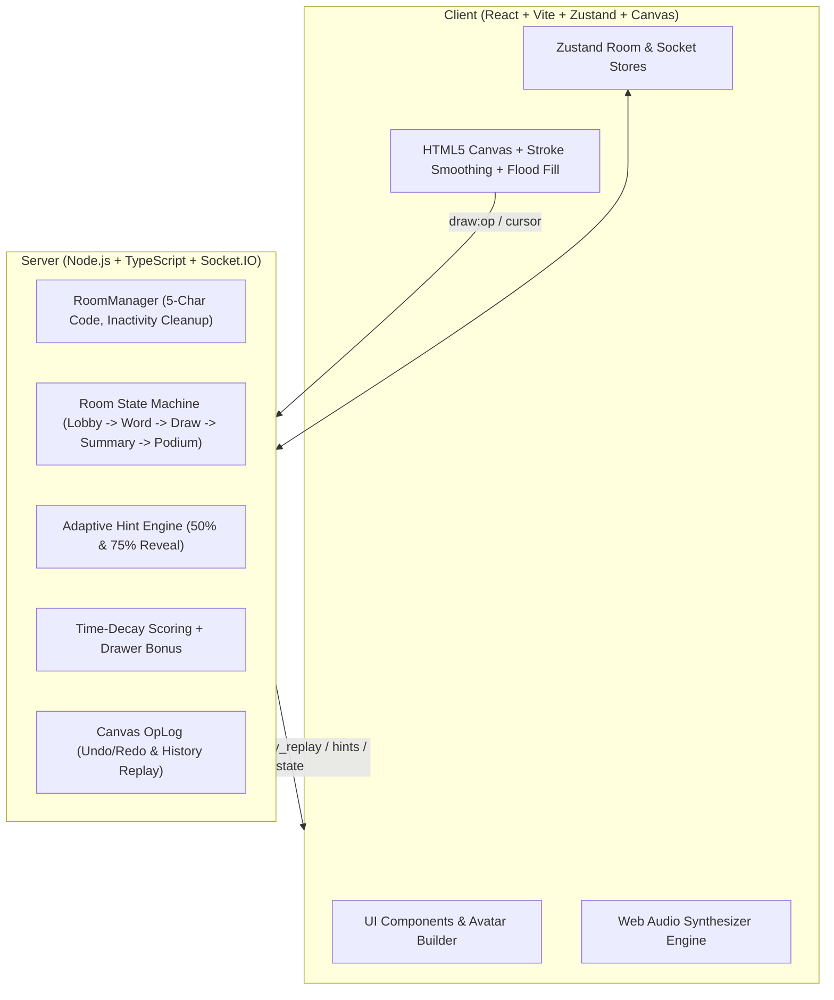

# 🎨 SketchRoom

> A premium, realtime social drawing and guessing party game inspired by Skribbl.io, engineered with a typed monorepo, HTML5 Canvas engine, and modern tactile design system.

[](LICENSE)
[](https://react.dev/)
[](https://www.typescriptlang.org/)
[](https://socket.io/)
[](https://tailwindcss.com/)

---

## 🌟 Key Features

- **Fluid HTML5 Drawing Engine**: Normalized coordinate system `[0.0, 1.0]`, Quadratic Bézier stroke smoothing, scanline flood fill, pressure sensitivity, shape tools (lines, rectangles, circles), and high-DPI scaling.
- **Server-Authoritative Realtime State**:
  - Full game cycle: Lobby → Word Choice (15s) → Drawing (30–120s) → Turn Summary (8s) → Victory Podium.
  - Timers, guess validation, and hint releases are authoritative on the server.
- **Composable SVG Avatar Builder**: 4 face shapes, 6 eye styles, 5 mouths, 7 accessories, and 10 skin/face colors, with randomized combinations and state animations (drawing pencil badge, correct guess bounce, disconnected sleepy state).
- **Proximity Detection & Guesser Chat**:
  - Edit-distance-1 typos trigger a private *"You're close!"* alert with gold screen pulse without spoiling the word for others.
  - Correct guessers automatically enter a private guesser sub-channel to chat safely during the turn.
- **Dynamic Letter Hint Engine**:
  - Automatically reveals 1st letter hint at 50% elapsed time and 2nd letter hint at 75% elapsed time, while keeping $\ge 50\%$ of the word masked.
  - Revealed letters animate with a 3D flip card effect.
- **Floating Live Reactions**: Floating emoji burst bar (👍, 😂, 😮, 🔥, ❤️, 👏) that drifts live over the shared canvas for all spectators.
- **Victory Podium & Art Gallery**:
  - 1st, 2nd, and 3rd place pedestals rise in sequence with crowns and confetti.
  - Every turn's final canvas snapshot is archived and presented in a gallery with one-click **Download All as ZIP** or per-image download.
- **Reconnection & Host Migration**:
  - 60-second slot protection via `sessionToken` stored in `localStorage`.
  - Automatic seamless host migration if the active host leaves the room.
- **Tactile Modern Design System**:
  - Accessible on `/styleguide` route.
  - 4 selectable accent themes: **Grape**, **Ocean**, **Sunset**, and **Mint**, with light and dark mode support.
  - Tactile physical depress buttons, soft layered shadows, and rounded-3xl cards.

---

## 🏗️ Architecture & State Machine



---

## 🕹️ Realtime Socket Contract

| Event | Direction | Payload | Description |
| :--- | :--- | :--- | :--- |
| `room:create` | C → S | `{ nickname, avatar, settings }` | Creates new 5-character private room |
| `room:join` | C → S | `{ roomCode, nickname, avatar, sessionToken? }` | Joins room or reclaims disconnected slot |
| `game:start` | C → S | `{}` | Host starts game (min 3 players) |
| `game:choose_word` | C → S | `{ wordIndex }` | Drawer selects 1 of 3 candidate words |
| `draw:op` | C → S | `{ op }` | Normalized stroke, shape, or flood fill |
| `draw:cursor_move` | C → S | `{ x, y }` | Broadcasts live drawer pointer to spectators |
| `chat:send` | C → S | `{ text }` | Player guess or chat message |
| `reaction:send` | C → S | `{ emoji }` | Broadcasts floating emoji reaction |
| `game:turn_start` | S → C | `{ drawerId, wordHint, secretWord? }` | Starts round; secret word sent only to drawer |
| `game:hint_reveal` | S → C | `{ wordHint, revealedIndices }` | 50% and 75% time letter reveals |
| `chat:correct_guess` | S → C | `{ playerId, playerName, pointsAwarded }` | Broadcasts player scored |
| `chat:close_guess` | S → C | `{ message }` | Private prompt: *"You're close!"* |
| `game:turn_end` | S → C | `{ word, scores }` | Reveals secret word and score breakdown |
| `game:game_over` | S → C | `{ podium, snapshots }` | Podium winners and gallery snapshots |

---

## 🚀 Quickstart & Local Setup

### Prerequisites
- Node.js $\ge 20$ (v22 or v24 recommended)
- npm $\ge 10$

### 1. Clone & Install Dependencies
```bash
git clone https://github.com/Bhargav221287/sketchroom.git
cd sketchroom
npm install
```

### 2. Run in Development Mode
To start shared TypeScript watcher, server on port 3001, and client Vite dev server on port 5173 concurrently:
```bash
npm run dev
```

Open your browser at `http://localhost:5173` to play! Visit `http://localhost:5173/styleguide` to view the design system components.

### 3. Run Tests
```bash
npm run test
```

### 4. Run 10-Player Headless Simulation Test
```bash
cd server
npx tsx src/scripts/simulateGame.ts
```

---

## ⚙️ Environment Variables

### Client (`/client/.env`)
```ini
VITE_SERVER_URL=http://localhost:3001
```

### Server (`/server/.env`)
```ini
PORT=3001
CLIENT_ORIGIN=http://localhost:5173,https://sketchroom.vercel.app
```

---

## 🌐 Production Deployment

### 1. Backend on Render (Web Service)
- Root Directory: `server`
- Build Command: `npm install && npm run build`
- Start Command: `npm start`
- Environment Variables:
  - `PORT`: `10000` (Render default)
  - `CLIENT_ORIGIN`: Your Vercel frontend URL (e.g. `https://sketchroom.vercel.app`)
- Health Check Path: `/health`

> **Note**: On Render's free tier, the web service automatically spins down after 15 minutes of inactivity. When a player connects to a sleeping server, SketchRoom automatically displays a friendly *"Waking up server..."* screen until the socket connects.

### 2. Frontend on Vercel
- Root Directory: `client`
- Framework Preset: `Vite`
- Build Command: `npm run build`
- Output Directory: `dist`
- Environment Variables:
  - `VITE_SERVER_URL`: Your Render backend service URL (e.g. `https://sketchroom-server.onrender.com`)
- SPA rewrites are pre-configured in `vercel.json` so direct links (`/room/ABCDE` and `/styleguide`) route cleanly.

---

## 📚 Word Bank Customization

SketchRoom includes 350+ categorized words across **Animals**, **Food**, **Objects**, **Actions**, and **Places** in `shared/src/words.json`.

To add more words:
1. Open `shared/src/words.json`.
2. Add words to existing categories or define a new category array:
```json
{
  "categories": {
    "space": ["asteroid", "black hole", "galaxy", "satellite", "space helmet"]
  }
}
```
3. Custom words can also be entered on-the-fly in any room by the host via the Lobby settings panel.

---

## 🎵 Audio & Asset Credits

- **Synthesized Audio**: Procedurally generated via the Web Audio API using smooth sine and triangle frequency sweeps (zero external bandwidth).
- **Icons**: [Lucide React](https://lucide.dev/) (ISC License).
- **Typography**: [Fredoka](https://fonts.google.com/specimen/Fredoka) and [Inter](https://fonts.google.com/specimen/Inter) via Fontsource (SIL Open Font License).

---

## 📄 License

MIT © 2026 SketchRoom Contributors
